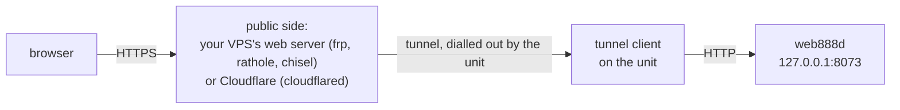

# Reaching the Web-888 from the Internet: tunnels

A Web-888 behind NAT can be put on the Internet without opening a port
on the router: the unit connects **out**, and something public faces the
browsers, with HTTPS. The image has four clients for this; each one runs
only when `web888.txt` sets it up. One is enough.



| | needs | the unit's connection | open on the server | client size |
|---|---|---|---|---|
| [frp](frp.md) | a VPS with `frps` and a web server | TLS (frp's default) | frps (7000), 80/443 | 13 MB |
| [cloudflared](#cloudflared-cloudflare-tunnel) | a Cloudflare account and a domain on Cloudflare | TLS to Cloudflare | nothing (no server of your own) | 37 MB |
| [rathole](#rathole) | a VPS with `rathole --server` and a web server | Noise (the server checked by its key) | rathole (2333), 80/443 | 1 MB |
| [chisel](#chisel) | a VPS with `chisel server` and a web server | SSH in a WebSocket, through HTTPS | 80/443 only | 9 MB |

* **frp** is the most used of the four. The details are in [frp.md](frp.md).
* **cloudflared** needs no server of your own. Cloudflare ends the HTTPS,
  so it sees the traffic, and its terms apply.
* **rathole** is the smallest. Its last release is from 2023 (0.5.0); the
  ARM build is UPX-packed and has Noise but no TLS.
* **chisel** goes through the VPS's web server, so the VPS needs no port
  but 80/443, and networks that allow only web traffic let it out.

## Common to all

* **web888-setup does the unit's side at boot.** It writes the client's
  configuration to `/run/web888/` (root only) and starts its service.
  `web888-setup.log` on the card says what it did and any problem. Remove
  a tunnel's lines from `web888.txt` and it is off after the next boot.
* **Secrets are taken off the card.** A token or password (`frp_token`,
  `cloudflared_token`, `rathole_token`, `chisel_auth`) is moved to the
  configuration partition (`/config/web888-setup/`) once read. Its line
  then reads `(set)`, as with `admin_password`. Write a new value on the
  line to change it. A malformed value is refused and the old one kept.
  Quotes, backslashes, `$`, `` ` `` and spaces are not allowed in any of
  them.
* **Visitors keep their own addresses.** The clients connect to web888d
  from 127.0.0.1, so web888-setup adds `"127.0.0.1"` to `[web]
  trusted_proxies` in `/config/web888d.toml`. web888d then takes the
  visitor from `X-Forwarded-For`: the rightmost address that isn't a
  trusted proxy. Without this, all visitors would share one address's
  `[limits] per_ip`. The web server in front must set `X-Forwarded-For`,
  as the nginx examples here do; Cloudflare does it itself.
* **The admin pages are public too.** That is the whole web888d port,
  `#/admin` and `/api/admin/*` included. Set a strong `admin_password`, or
  refuse `/api/admin` at the web server (see [frp.md](frp.md), section 3)
  and administer from the LAN.
* **Checks on the unit (SSH):**
  * `systemctl status frpc` (or `cloudflared`, `rathole`, `chisel`);
  * `journalctl -u <the same>`;
  * in the admin pages' sessions list, the visitors' addresses: they
    should be theirs, not 127.0.0.1.

The web server examples below are for nginx and share these settings for
the WebSocket (audio and waterfall) and the visitor's address:

```nginx
        proxy_http_version 1.1;
        proxy_set_header Host              $host;
        proxy_set_header X-Forwarded-For   $remote_addr;
        proxy_set_header X-Forwarded-Proto $scheme;
        proxy_set_header Upgrade    $http_upgrade;
        proxy_set_header Connection "upgrade";
        proxy_read_timeout  1h;
        proxy_send_timeout  1h;
        proxy_buffering off;
```

## cloudflared (Cloudflare Tunnel)

At Cloudflare (Zero Trust dashboard, Networks, Tunnels):

1. Create a tunnel of the type *Cloudflared*.
2. From the install command it shows, copy the token: the long string
   after `--token`.
3. Add a public hostname (e.g. `web888.example.org`, on a domain that is
   on Cloudflare) with the service *HTTP*, `localhost:8073`.

On the card:

```
cloudflared_token = eyJhIjoi...
```

Cloudflare carries the WebSocket and sets `X-Forwarded-For`. The browser
gets HTTPS, so audio plays with the AudioWorklet. To keep the admin pages
to yourself, Cloudflare Access can put a login in front of
`web888.example.org/api/admin` (Zero Trust, Access, Applications).

The client uses QUIC (UDP 7844) and falls back to HTTP/2 over TCP 443.
Messages about the UDP receive buffer in its log are harmless.

## rathole

On the VPS, with rathole 0.5.0 (the version the unit has):

```sh
rathole --genkey      # prints a private and a public key
```

`/etc/rathole/server.toml`:

```toml
[server]
bind_addr = "0.0.0.0:2333"

[server.transport]
type = "noise"

[server.transport.noise]
local_private_key = "<the private key>"

[server.services.web888]           # the unit's rathole_name
token = "<a long random string>"   # the unit's rathole_token
bind_addr = "127.0.0.1:18088"      # for the local web server only
```

Run it with `rathole --server /etc/rathole/server.toml`, for example from
a systemd unit. Then nginx forwards a site to the service's port:

```nginx
server {
    listen 443 ssl;
    server_name web888.example.org;
    # ssl_certificate ... (certbot)
    location / {
        proxy_pass http://127.0.0.1:18088;
        # and the common settings above
    }
}
```

On the card:

```
rathole_server = vps.example.org:2333
rathole_server_key = <the public key>
rathole_token = <the same token>
#rathole_name = web888
```

Noise is required. The unit refuses to start the tunnel without
`rathole_server_key`, so the token and the receiver's traffic never
cross the Internet unencrypted. A second unit needs a service of its own
(name, token, port) in `server.toml`.

## chisel

chisel's server answers HTTP: it can sit behind the VPS's web server on
a hostname of its own, and the unit reaches it with HTTPS on port 443.
The reverse tunnel opens a port on the VPS's loopback, which a second
site forwards to.

On the VPS, with chisel 1.12 or newer:

```sh
chisel server --keygen /etc/chisel/key     # once; the fingerprint is in the server's log
```

`/etc/chisel/users.json`, so this user can open only this one port:

```json
{ "web888:<a long random password>": ["^R:127\\.0\\.0\\.1:18088$"] }
```

Run it with:

```sh
chisel server --host 127.0.0.1 --port 8081 --reverse \
    --keyfile /etc/chisel/key --authfile /etc/chisel/users.json
```

nginx then has two sites: the tunnel's, and the receiver's.

```nginx
server {                               # the unit connects here
    listen 443 ssl;
    server_name tunnel.example.org;
    location / {
        proxy_pass http://127.0.0.1:8081;
        proxy_http_version 1.1;
        proxy_set_header Upgrade    $http_upgrade;
        proxy_set_header Connection "upgrade";
        proxy_read_timeout 1h;
    }
}
server {                               # the public
    listen 443 ssl;
    server_name web888.example.org;
    location / {
        proxy_pass http://127.0.0.1:18088;
        # and the common settings above
    }
}
```

On the card:

```
chisel_server = https://tunnel.example.org
chisel_auth = web888:<the same password>
chisel_remote_port = 18088
chisel_fingerprint = <the server's fingerprint, 44 characters>
```

The unit asks for `R:127.0.0.1:<chisel_remote_port>:127.0.0.1:8073`. The
port is on the VPS's loopback only, never public. Without
`chisel_fingerprint` the tunnel still runs, but the server's own key is
not checked; with `https://` its certificate still is.

## Sources (checked 2026-10-30)

The recipes pin each release by its SHA-256.

* frp 0.71.1: https://github.com/fatedier/frp/releases/tag/v0.71.1
  (`frp_0.71.1_linux_arm_hf.tar.gz`).
* cloudflared 2026.10.1: https://github.com/cloudflare/cloudflared/releases/tag/2026.10.1
  (`cloudflared-linux-armhf`). The token can also come from the
  `TUNNEL_TOKEN` variable, which the unit uses.
* rathole 0.5.0: https://github.com/rapiz1/rathole/releases/tag/v0.5.0
  (`rathole-armv7-unknown-linux-musleabihf.zip`, built with the
  `embedded` features: client, server, Noise; packed with UPX). The
  transport settings are in its README.
* chisel 1.12.0: https://github.com/jpillora/chisel/releases/tag/v1.12.0
  (`chisel_1.12.0_linux_armv7.gz`). The client reads `AUTH` from the
  environment. Authfile remotes have the form `R:<interface>:<port>`.
